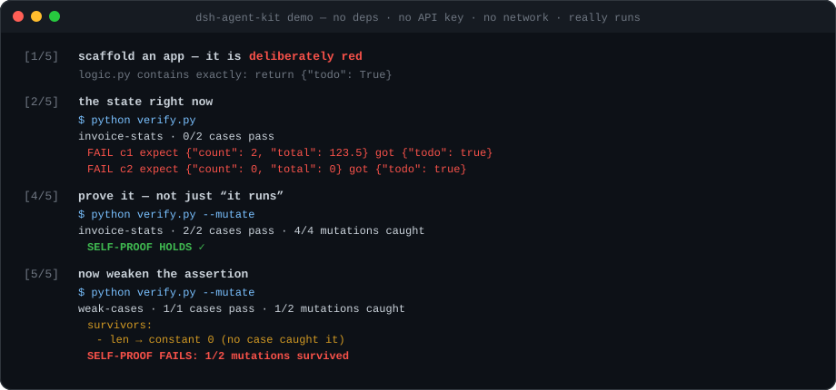

# Make AI-written code prove itself

> **`qed`** — *quod erat demonstrandum*. The mark you put at the end of a proof.
> Your agent says "done"; this is where "done" has to come with evidence.
>
> **The open-source answer to Claude's “Install as app”** — same core idea (AI output becomes
> a real desktop app, no packaging, no signing), plus the part everyone leaves out:
> **proof that the code is actually correct.**
>
> A test that always passes proves nothing — and most AI-written tests always pass.
> This project adds the second lock: **mutation testing**, which catches whether your
> assertions can actually be fooled.

```bash
git clone https://github.com/tongriyaotxt/qed
pip install -e qed/python
qed demo      # 60s · no deps · no API key · no network · everything really runs
```

<sub>Not on PyPI yet — `pip install qed` starts working once it is.</sub>

<p align="center">
  
</p>

<p align="center"><sub>Everything in that screenshot is produced by <code>qed demo</code> — nothing is faked.</sub></p>

---

## The problem, in one table

| | Plain unit tests | "AI says it's done" | This |
|---|---|---|---|
| Catches wrong output | ✅ | ❌ | ✅ |
| **Catches a test that can never fail** | ❌ | ❌ | **✅** |
| Requires you to read the code | sometimes | — | ❌ |
| Works when the agent wrote both code and tests | ❌ | ❌ | ✅ |

Every AI coding tool can produce a green test suite. **Almost none of them can tell you
whether that green means anything.** Mutating the source and watching the tests stay green
is the only cheap way to find out.

## What it actually is

Three layers, each small enough to read in one sitting:

| Layer | What it does | Size |
|---|---|---|
| **Protocol** | `dsh --json` emits NDJSON; a schema, three invariants, and a [regression test against a real capture](tests/test_protocol_live.py) | 1 schema + 2 docs |
| **Self-proof** | `cases.json` + `verify.py --mutate`: green cases **and** caught mutations, or it's not done | ~400 lines, zero deps |
| **Host** | A 7.6 MB Go + WebView2 window that lists `~/apps/*`, runs one, streams the events | ~700 lines |

The self-proof layer is the point. The other two exist so you can actually use it.

## Quick start (no dsh required)

```bash
git clone https://github.com/tongriyaotxt/qed
pip install -e qed/python

# 1. Generate an app — it is *deliberately* red
python -m qed.scaffold 发票统计 --desc "sum invoices by month"

# 2. It fails, and that's honest
cd ~/apps/发票统计
python verify.py
#   发票统计 · 0/2 用例通过
#     FAIL c1  期望 {"count": 2, "total": 123.5}，实际 {"todo": true}

# 3. Write the logic, then ask it to prove itself
python verify.py --mutate
#   发票统计 · 2/2 用例通过 · 变异 4/4 被抓
#     自证成立 ✓
```

`verify.py --mutate` exits non-zero unless **both** locks hold. Wire it into CI and an
agent that "forgot" a case can't merge.

## Using it with an agent

`AGENT_RULES.md` (generated by the scaffold) makes the order non-negotiable:
**cases first, UI second**. The agent is told to run `verify.py --mutate` and paste the
result — and the host refuses to render a window when `cases.json` is missing.

Measured: a fresh app went from scaffold to `自证成立 ✓` in **35 seconds** of agent time,
with the agent self-checking that `cases.json` was untouched and no `_mutant_*` files leaked.

## With a real agent runtime (dsh)

If you have [DeepSeek Harness](https://github.com/deepseek-ai/deepseek-harness) installed,
the same kit drives it over `dsh --profile headless --json -`:

```bash
dsh --patch configs/cred.patch.yml --profile headless --json -   # stdin = task, stdout = NDJSON
```

- [`docs/02-protocol.md`](docs/02-protocol.md) — event schema, invariants, real captures
- [`docs/03-profiles.md`](docs/03-profiles.md) — profiles, `--patch` order traps, the
  `MISSING_CREDENTIAL` footgun
- [`docs/11-quickstart.md`](docs/11-quickstart.md) — the 5-minute path
- [`docs/09-issues.md`](docs/09-issues.md) — 76-item backlog, P0/P1/P2, with measured status
- [`docs/16-incident-2026-11-27-encoding.md`](docs/16-incident-2026-11-27-encoding.md) — incident
  file: a `print` took the whole gate down (`cp1252` vs `≈`), and the two locks that stop it recurring

## Relation to Claude's “Install as app”

Anthropic shipped [Install as app](https://claude.com/resources/articles/install-as-app) in
November 2026: describe an app to Claude, get an artifact, click once, and it opens as a real
Mac/Windows window — no packaging, no code signing, no API key, because the host app is already
signed and the artifact is just data.

**This project is the open-source implementation of that idea**, with one deliberate addition.

| | Claude · Install as app | This |
|---|---|---|
| Host | Claude desktop app (signed, online, tied to your Claude account) | Your own 7.6 MB Go + WebView2 binary |
| What you build | An artifact (HTML/JS) | A folder: `logic.py` + `cases.json` |
| How you know it's right | You run it and look at it | Cases green **and** mutations caught |
| Needs an account / network | Yes | No |
| Deliverable to someone else | They need Claude | Send the folder; they run `verify.py` |

The last two rows aren't a feature list — they're the structural differences. Claude's version
can't leave the account boundary; this one can't match their zero-setup polish. Pick accordingly.

## What it is **not**

- **Not another AI coding tool.** It doesn't write code. It decides whether the code that
  was written is allowed to call itself done.
- **Not a test framework.** It doesn't replace pytest. It answers a different question:
  are your tests capable of failing?
- **Not a Claude/Cursor replacement.** Point your existing agent at a scaffolded app and
  it works better, because there's finally a definition of "done".

## Quality gates (all reproducible)

```
pytest 53          # protocol + verify + broker + guard + scaffold + demo
conformance        # three invariants against fixtures and real captures
negative 18        # the checker itself must be violable
protocol_live 6    # pinned against a real 13-event capture
mutate 6/6         # injected bugs must turn the suite red
examples 6/6       # examples can't rot
docs drift         # documented numbers must match reality
node 10            # the Node client matches the Python one
go test 8          # host keystore: migration must self-verify and roll back
```

The rule behind all of it: **a gate you can't violate is decoration.**
`tests/test_conformance_negative.py` exists because we found the conformance checker could
be silently disabled while everything stayed green.

## Status

Early. The self-proof layer and the protocol are measured and stable; the host is a working
prototype; multi-window, PDF/Excel input, and process whitelisting are not done.
See [`docs/09-issues.md`](docs/09-issues.md) for the honest list.

MIT licensed.

---

中文版：[`README.zh.md`](README.zh.md) · 文档索引：[`docs/`](docs/)
